# Dapple

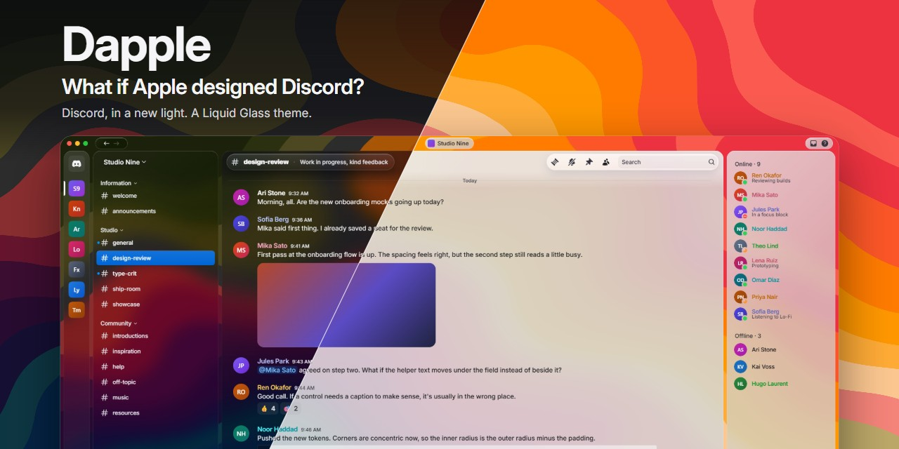

**What if Apple designed Discord?**

Discord, in a new light. A Liquid Glass theme for Equicord, Vencord and BetterDiscord, in pure CSS, with no plugins and nothing to host.

## Versions

Every version is glass over a wallpaper. Only the weight of the glass changes.

| Theme | Feel |
| --- | --- |
| **Dapple** | Liquid Glass, transparent and lightly frosted. Follows your Discord light or dark setting. |
| **Dapple Light** | Liquid Glass, but lighter. |
| **Dapple Dark** | Liquid Glass, but darker. |

Enable one at a time.

| | Dark | Light |
| --- | --- | --- |
| **Dapple** |  | 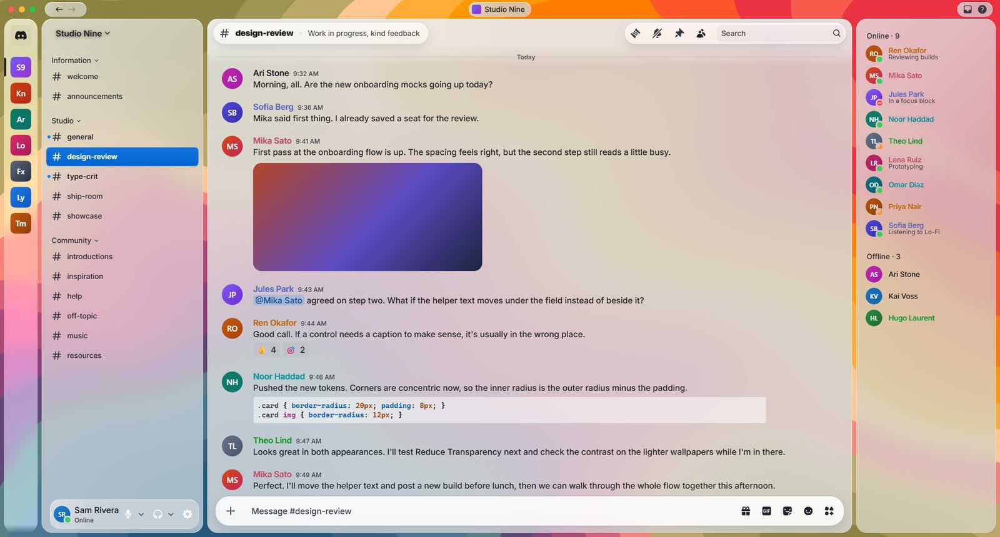 |
| **Dapple Dark and Dapple Light** | 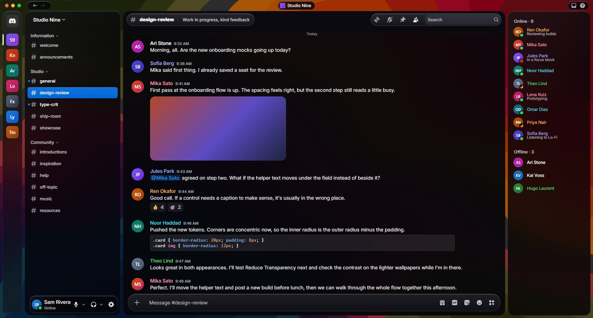 | 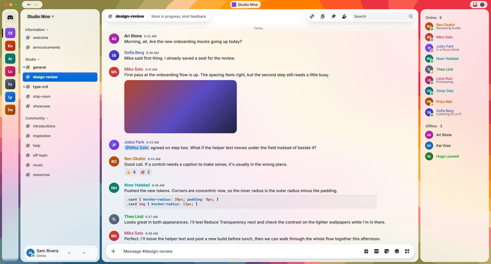 |

<sub>Every screenshot is a real capture of Dapple in Discord. The server, people and messages are placeholders.</sub>

## Flavours

Dapple's wallpapers are [Topographic Amoeba](https://basicappleguy.com/basicappleblog/topographic-amoeba) by Basic Apple Guy, used with permission. Each version uses **Arcella Alps**. To change it, turn on one Flavour alongside your version:

Chaos Ridge · Difflugia Divide · Pelomyxa Pass · Proteus Valley · Vannella Hills

Each Flavour swaps between a Light and Dark image to match your version.

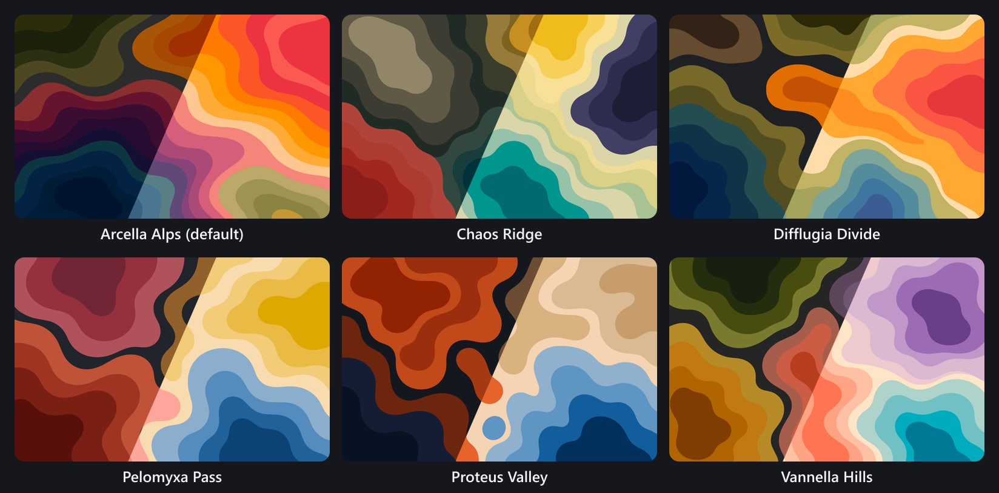

| | Dark | Light |
| --- | --- | --- |
| **Chaos Ridge** | 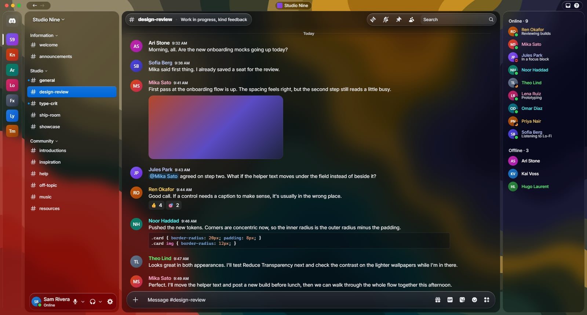 | 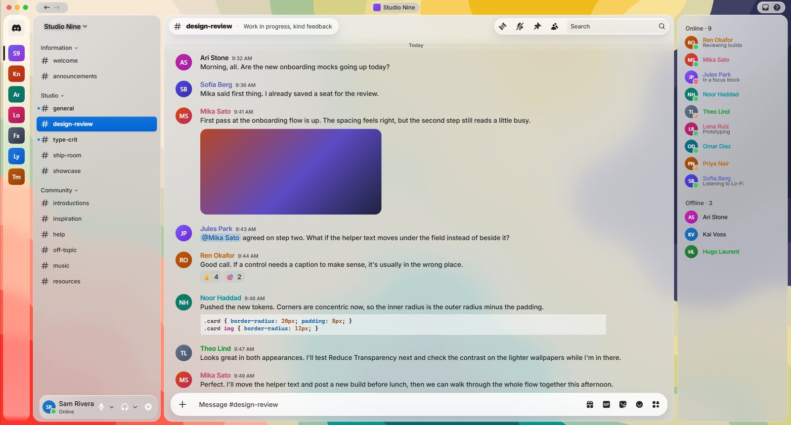 |
| **Difflugia Divide** | 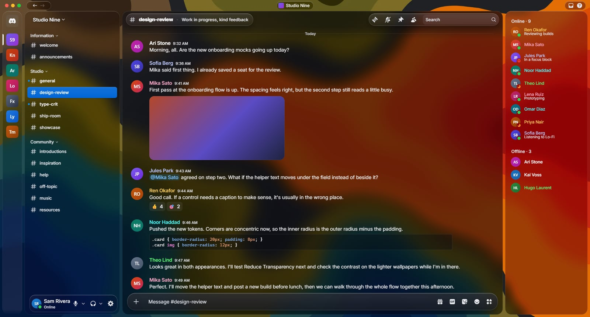 | 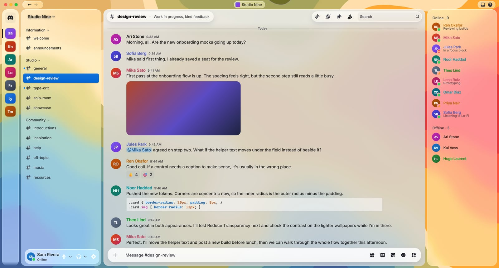 |
| **Pelomyxa Pass** | 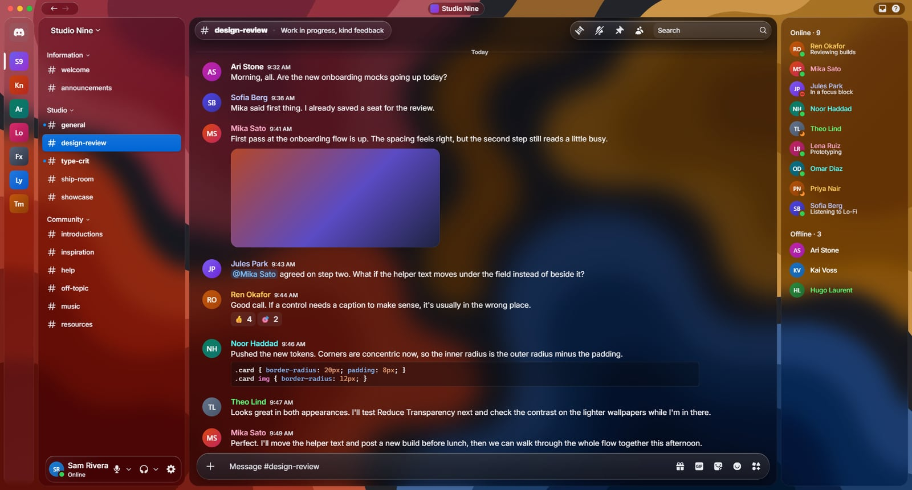 | 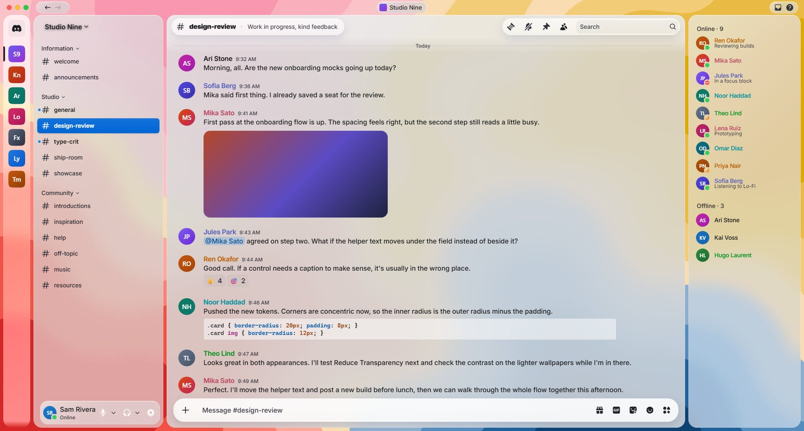 |
| **Proteus Valley** | 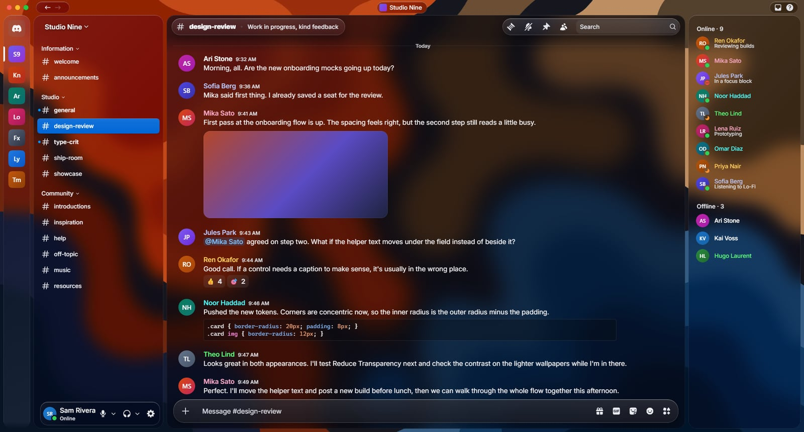 | 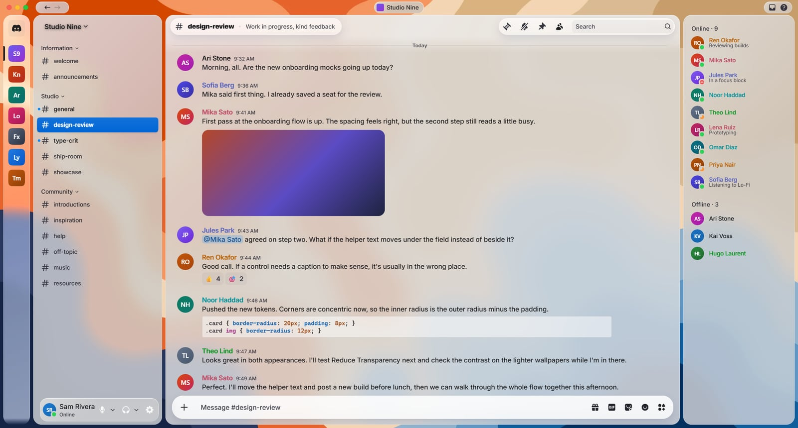 |
| **Vannella Hills** | 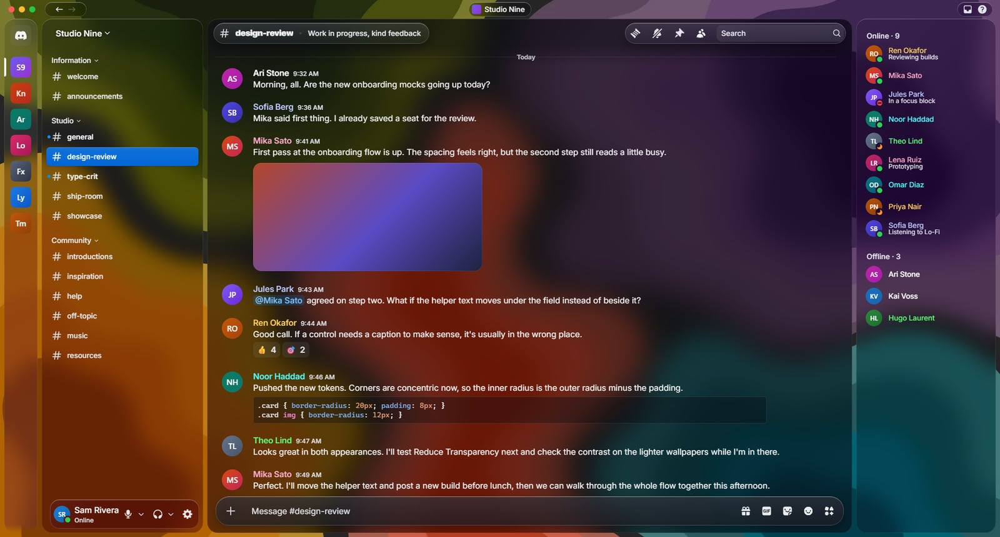 | 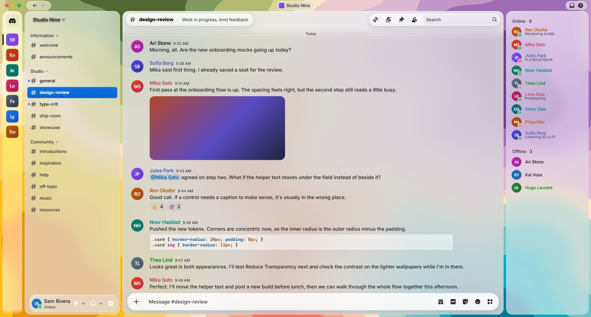 |

## Install

### With a link (recommended)

Fixes reach you automatically, with nothing to download again. In Equicord or Vencord, open Settings → Themes → Online Themes and paste:

```text
https://raw.githubusercontent.com/anthonyf2312/Dapple/main/dist/Dapple.theme.css
```

For the other versions, end the link with `Dapple-Light.theme.css` or `Dapple-Dark.theme.css`. Flavours work the same way, from `dist/flavours/`.

### As a file

This is the way to install on BetterDiscord. If Discord breaks something, you'll need to download the fixed file yourself.

1. Download a version from [`dist/`](dist) and, if you want one, a Flavour from [`dist/flavours/`](dist/flavours).
2. Put the files in your themes folder. In Equicord, Vencord and BetterDiscord, that's Settings → Themes → Open Themes Folder.
3. Enable them in the Themes tab.

However you install it, turn off any other full theme, because two themes restyling the same elements will clash.

## Less blur

Blur is what makes glass look like glass, but it's also the heaviest thing Dapple asks of your PC. If Discord feels slow, or you'd rather read on solid panels, turn on **No Blur** alongside your version. It's in [`dist/flavours/`](dist/flavours), and it works with any wallpaper Flavour.

## Make it yours

Add this to your QuickCSS and change the values:

```css
html:root {
  --dapple-accent: #34c759; /* buttons, selected rows and links */
  --dapple-gap: 8px; /* space between the floating panels */
  --dapple-corners: 20px; /* roundness of the floating panels */
}
```

Text on your accent colour turns black or white by itself, so it stays readable.

## Font

Dapple is made to be used with San Francisco, the font Apple uses across its devices. It's what makes Dapple feel the most like a real Apple app.

- **On a Mac,** there's nothing to do. Dapple already uses it.
- **On Windows or Linux,** Dapple uses [Inter](https://rsms.me/inter/), the closest free match. If SF Pro is installed, Dapple switches to it by itself, with no settings to change.

**[Download SF Pro from Apple](https://developer.apple.com/fonts/)**

Good to know before you download it:

- It's a separate download because Apple's licence doesn't allow SF Pro to be included with a theme.
- The download is a Mac installer, and the licence is written for designing apps for Apple's platforms, so please read Apple's terms to check they cover what you want to do.
- Install every weight, not just one. With a single weight installed, every title uses that weight, so one heavy file makes all your titles extra bold.

## Your own wallpaper

Add this to your QuickCSS. The image has to be on a host your client allows, such as `i.imgur.com` or `*.github.io`.

```css
html:root {
  --dp-wallpaper-dark: url("https://example.com/dark.jpg");
  --dp-wallpaper-light: url("https://example.com/light.jpg");
}
```

The built-in wallpapers are each measured when Dapple is built, so they get exactly as much dimming as they need. A custom image uses Arcella Alps' values, so a very bright one may need these too:

```css
html:root {
  --dp-dim-panel: 0.55;   /* lower is darker */
  --dp-dim-content: 0.45;
}
```

## What's in it

- **Liquid Glass with real refraction.** The message box bends what scrolls beneath it, in pure CSS.
- **Floating layout.** A Dock for servers with magnification, a source list for channels, an inspector for members, and a toolbar and composer that messages scroll under.
- **Mac traffic lights on Windows.** They're your real window buttons, restyled, so they all still work.
- **Squircle server icons and rows,** and Apple's spring motion, with no JavaScript.
- **Made for Apple's San Francisco font,** with Inter, the closest free match, until you [add it](#font).
- **Respects your settings.** Reduce Motion, Reduce Transparency and Increase Contrast are all supported, along with Discord's Saturation and chat font size settings.
- **Works with Nitro themes.** Client themes are neutralised so they don't tint the glass.

## Compatibility

Developed and tested on Equicord on Windows. It targets Discord's current Chromium, and older clients lose squircles and the refraction effect but stay usable. Vencord and BetterDiscord use the same CSS but haven't been tested yet.

Discord changes the random ending on its class names often. Dapple matches the start of each name, so it survives most updates, but something may still break after a big one. If you installed with a link, the fix reaches you automatically.

## Building

```bash
npm install
npm run build
```

Tokens live in `src/tokens.css` and styles in `src/theme.css`. The build writes every theme to `dist/`, with wallpapers embedded.

## Credits

- **Wallpapers:** [Topographic Amoeba](https://basicappleguy.com/basicappleblog/topographic-amoeba) by Basic Apple Guy, used with his permission. They're free to download, and he takes [the WinRAR approach](https://basicappleguy.com/basicappleblog/the-winrar-approach): the collection is an optional way to support his work. If you enjoy them, please consider it.

## License

Dapple's code is released under the [MIT License](LICENSE). The wallpapers in `assets/`, and the copies embedded in `dist/`, are not covered by it. They belong to their creators.

---

Dapple is an independent project, not affiliated with or endorsed by Apple, Discord or Basic Apple Guy. SF Pro and SF Symbols are not included.
