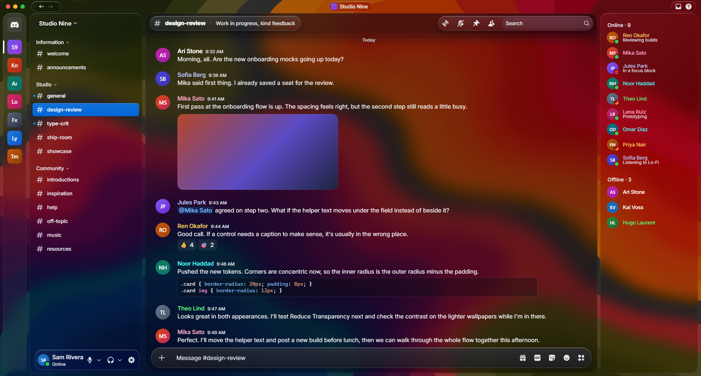

# Dapple

**What if Apple designed Discord?**

Discord, in a new light. A Liquid Glass theme for Equicord, Vencord and BetterDiscord, in pure CSS, with no plugins and nothing to host.



<sub>A real capture of Dapple in Discord. The server, people and messages are placeholders.</sub>

## Versions

Every version is glass over a wallpaper. Only the weight of the glass changes.

| Theme | Feel |
| --- | --- |
| **Dapple** | Liquid Glass, transparent and lightly frosted. Follows your Discord light or dark setting. |
| **Dapple Light** | Liquid Glass, but lighter. |
| **Dapple Dark** | Liquid Glass, but darker. |

Enable one at a time.

## Flavours

Each version uses the Blue wallpaper. To change it, turn on one Flavour alongside your version:

Skyblue · Green · Yellow · Orange · Red · Purple · Silver

Each Flavour swaps between a Light and Dark image to match your version.

## Install

1. Download a version from [`dist/`](dist) and, if you want one, a Flavour from [`dist/flavours/`](dist/flavours).
2. Put the files in your themes folder:
   - **Equicord or Vencord:** Settings → Themes → Open Themes Folder
   - **BetterDiscord:** Settings → Themes → Open Themes Folder
3. Enable them in the Themes tab. Turn off any other full theme, because two themes restyling the same elements will clash.

## Your own wallpaper

Add this to your QuickCSS. The image has to be on a host your client allows, such as `i.imgur.com` or `*.github.io`.

```css
html:root {
  --dp-wallpaper-dark: url("https://example.com/dark.jpg");
  --dp-wallpaper-light: url("https://example.com/light.jpg");
}
```

The built-in wallpapers are each measured when Dapple is built, so they get exactly as much dimming as they need. A custom image uses the Blue wallpaper's values, so a very bright one may need these too:

```css
html:root {
  --dp-dim-panel: 0.55;   /* lower is darker */
  --dp-dim-content: 0.45;
}
```

## What's in it

- **Liquid Glass with real refraction.** The message box bends what scrolls beneath it, in pure CSS.
- **Floating layout.** A Dock for servers with magnification, a source list for channels, an inspector for members, and a toolbar and composer that messages scroll under.
- **Mac traffic lights on Windows.** They're your real window buttons, restyled, so they all still work.
- **Squircle server icons and rows,** and Apple's spring motion, with no JavaScript.
- **Respects your settings.** Reduce Motion, Reduce Transparency and Increase Contrast are all supported.
- **Works with Nitro themes.** Client themes are neutralised so they don't tint the glass.

## Compatibility

Developed and tested on Equicord on Windows. It targets Discord's current Chromium, and older clients lose squircles and the refraction effect but stay usable. Vencord and BetterDiscord use the same CSS but haven't been tested yet.

Discord changes its class names often. Dapple matches stable class stems so it survives most updates, but something may still break after a big one.

## Building

```bash
npm install
npm run build
```

Tokens live in `src/tokens.css` and styles in `src/theme.css`. The build writes every theme to `dist/`, with wallpapers embedded.

## Credits

- **Wave wallpapers:** [Sound.wav](https://basicappleguy.com/basicappleblog/soundwav) by Basic Apple Guy. They're free to download, and he takes [the WinRAR approach](https://basicappleguy.com/basicappleblog/the-winrar-approach): the bundle is an optional way to support his work. If you enjoy them, please consider it.

## License

Dapple's code is released under the [MIT License](LICENSE). The wallpapers in `assets/`, and the copies embedded in `dist/`, are not covered by it. They belong to their creators.

---

Dapple is an independent project, not affiliated with or endorsed by Apple, Discord or Basic Apple Guy. SF Pro and SF Symbols are not included.
